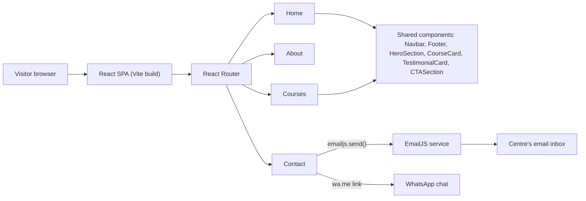

# Knowledge Nest

A responsive marketing website for a personalised tuition centre (Class 6–12), built with React, React Router and Tailwind CSS, with a contact form that delivers enquiries by email through EmailJS.


## Overview

Small, local tuition centres usually rely on word of mouth and phone calls, so parents have no single place to see what is taught, for which classes, and how to get in touch. Knowledge Nest is the public website for such a centre. It presents the centre's approach (experienced tutors, small batches, personal attention), lists the courses on offer from foundation classes to JEE/NEET-oriented science coaching, and turns visitors into enquiries through a validated contact form and a WhatsApp call to action.

The site is a front-end only single-page application: there is no custom backend or database. Enquiries are sent straight from the browser to the centre's inbox using the [EmailJS](https://www.emailjs.com/) service.

## Key features

- **Four pages** with client-side routing: Home, About, Courses and Contact.
- **Home page**: hero section, "why choose us" feature grid, three featured courses, parent and student testimonials, and a call-to-action banner.
- **Courses catalogue**: six programmes rendered from a data array through a reusable `CourseCard` component (level badge, description, subject tags, icon, and an "Enquire Now" link to the contact page):
  - Complete Foundation (Class 6–8), Board Exam Excellence (Class 9–10)
  - Physics Mastery, Chemistry Expert, Biology Scholar (Class 11–12, CBSE/ICSE with JEE/NEET focus)
  - English Language (all classes)
- **About page**: vision, mission and the centre's teaching values.
- **Contact page**: centre contact details, a WhatsApp button, and an enquiry form with client-side validation (required fields, email format, 10-digit phone number), a loading state while sending, and a confirmation message on success.
- **Email delivery via EmailJS**: form submissions are sent as an email template (name, email, phone, message, reply-to).
- **Responsive navigation**: fixed navbar that becomes a blurred, shadowed bar on scroll, with a mobile hamburger menu.
- **UX details**: scroll-to-top on every route change, smooth scrolling, Inter font, custom Tailwind colour palette and fade/slide-up animations.

## Architecture



| Component | Responsibility |
|---|---|
| [`src/App.jsx`](src/App.jsx) | Router setup and page layout: `ScrollToTop`, `Navbar`, the routed page, `Footer`. |
| [`src/pages/`](src/pages) | One component per route. Page content (features, courses, testimonials) is defined as in-file data arrays. |
| [`src/components/`](src/components) | Reusable UI building blocks shared across pages. |
| [`src/pages/Contact.jsx`](src/pages/Contact.jsx) | Form state, validation and the EmailJS call. |
| EmailJS | Third-party service that turns the form payload into an email using a pre-configured template. |

## How it works

1. Vite serves (or builds) a static bundle; React Router maps `/`, `/about`, `/courses` and `/contact` to page components without full page reloads.
2. Pages render content from local arrays (for example the `courses` array in `Courses.jsx`) through presentational components such as `CourseCard` and `TestimonialCard`.
3. Every "Enquire Now" and call-to-action button routes the visitor to the Contact page.
4. On submit, the Contact form validates every field. If valid, it calls `emailjs.send(serviceId, templateId, params, publicKey)` with `from_name`, `from_email`, `phone_number`, `message`, `to_name` and `reply_to`.
5. On success the form is replaced by a thank-you message and resets after five seconds; on failure the visitor sees an error alert.

## Tech stack

| Layer | Technologies |
|---|---|
| UI framework | React 19 |
| Routing | React Router 7 |
| Styling | Tailwind CSS 3, PostCSS, Autoprefixer, Google Fonts (Inter) |
| Icons | lucide-react |
| Email | @emailjs/browser |
| Tooling | Vite 7, ESLint 9 |

## Project structure

```
Knowledge_Nest/
├── index.html                  # HTML shell, page title and meta description
├── tailwind.config.js          # Custom colours (primary, secondary, education) and animations
├── vite.config.js
└── src/
    ├── main.jsx                # React entry point
    ├── App.jsx                 # Router and page layout
    ├── index.css               # Tailwind layers, font import, utility classes
    ├── pages/
    │   ├── Home.jsx            # Hero, features, featured courses, testimonials, CTA
    │   ├── About.jsx           # Vision, mission and values
    │   ├── Courses.jsx         # Full course catalogue
    │   └── Contact.jsx         # Contact details and EmailJS enquiry form
    └── components/
        ├── Navbar.jsx          # Fixed, scroll-aware, mobile-friendly navigation
        ├── Footer.jsx          # Links and contact summary
        ├── HeroSection.jsx     # Landing hero with calls to action
        ├── CourseCard.jsx      # Reusable course card
        ├── TestimonialCard.jsx # Star-rated testimonial card
        ├── CTASection.jsx      # Enrolment call-to-action banner
        └── ScrollToTop.jsx     # Resets scroll position on route change
```

## Getting started

### Prerequisites

- Node.js and npm

### Install and run

```bash
git clone https://github.com/suriyaprakash-25/Knowledge_Nest.git
cd Knowledge_Nest
npm install
npm run dev
```

Vite serves the site at `http://localhost:5173`.

### Scripts

| Command | Purpose |
|---|---|
| `npm run dev` | Start the development server |
| `npm run build` | Production build into `dist/` |
| `npm run preview` | Serve the production build locally |
| `npm run lint` | Run ESLint |

### Configuration

There are no environment variables. The EmailJS service ID, template ID and public key are set directly in [`src/pages/Contact.jsx`](src/pages/Contact.jsx). To send enquiries to your own inbox, create an EmailJS account, add an email service and a template that uses the parameters listed in "How it works", and replace those three values.

When deploying to a static host, configure a fallback to `index.html` so that direct visits to `/about`, `/courses` or `/contact` work with client-side routing.

No automated tests are included.

## Limitations and roadmap

- **Static content**: courses, features and testimonials are hardcoded in the page components; the testimonials are sample content.
- **Placeholder links**: the WhatsApp button uses a placeholder number, the CTA banner's WhatsApp button points to a `/whatsapp` route that does not exist, and the footer's social icons link to `#`.
- **EmailJS keys in source**: the EmailJS identifiers are committed in code. EmailJS public keys are meant to be used in the browser, but moving them to Vite environment variables and enabling EmailJS domain restrictions would reduce the risk of spam through the account.
- **Unused dependency**: `framer-motion` is installed but not used; animations are CSS/Tailwind based.
- No SPA rewrite configuration for a specific host and no tests.

Possible next steps: fix the WhatsApp links, move content to a JSON file or headless CMS, add real testimonials and images, move EmailJS settings to environment variables, and add SEO metadata per page.

## Author

Built by [Suriyaprakash](https://github.com/suriyaprakash-25).
